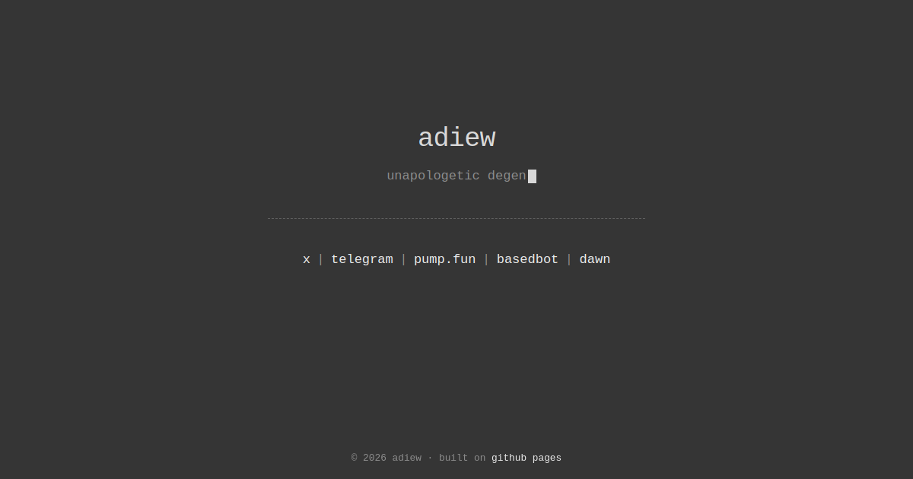

# adiew

unapologetic degen, live at [adi3www.fun](https://adi3www.fun/).

## what is this

a one-screen personal website. text only, dark gray, old web style.

## links

- [x](https://x.com/adi3www)
- [telegram](https://t.me/adi3wwwfun)
- [spotify](https://open.spotify.com/user/31kq6tck5pgbsc7tm3xl42gslgkq)
- trading tools
  - [pump.fun](https://pump.fun/u/adi3www)
  - [terminal](https://trade.padre.gg/rk/adi3www)
  - [basedbot](https://t.me/based_eth_bot?start=r_adi3www)

some links are referral links.

## built with

plain html, css, and a tiny bit of js. no frameworks, no build step for the site itself, no cookies, no trackers. hosted on github pages. the link preview image is generated automatically from the page by a github action.

## security

see [SECURITY.md](SECURITY.md).
