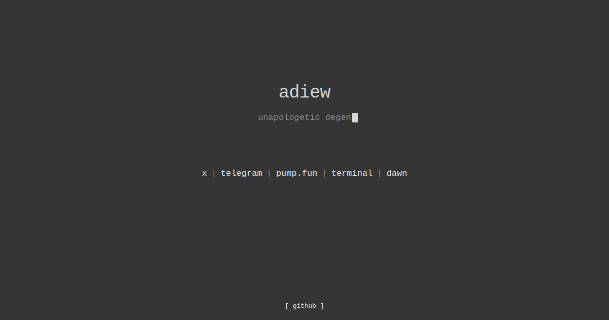
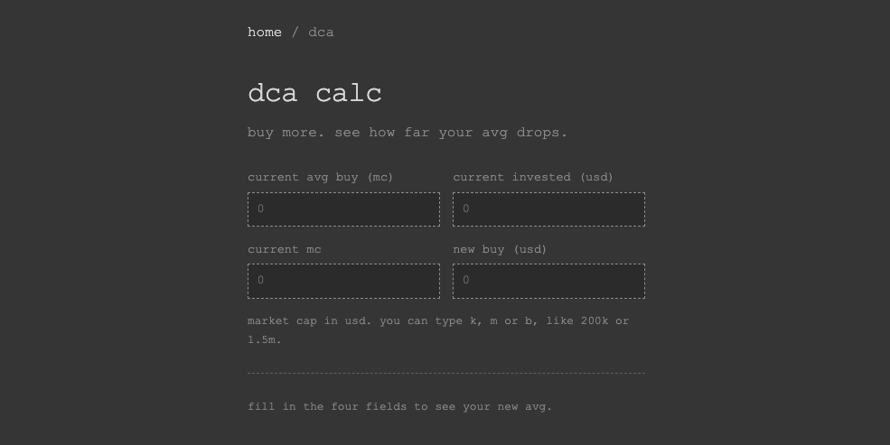
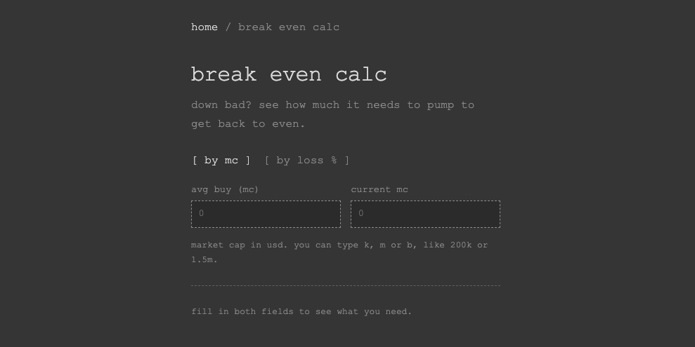

# adiew

personal website and memecoin tools by adiew, live at [adi3www.github.io](https://adi3www.github.io/).

## pages

| page | what it does |
| --- | --- |
| [home](https://adi3www.github.io/) | links to x, telegram, pump.fun, terminal and dawn |
| [dca calc](https://adi3www.github.io/dca-calc/) | add to a position and see how far your avg buy drops |
| [break even calc](https://adi3www.github.io/break-even-calc/) | see how much a coin needs to pump to get back to even |

## home

a one-screen page with my links. text only, dark gray, old web style.

## dca calc

enter your avg buy (mc), amount invested, current mc and a new buy. it shows your new avg buy and how many percent it drops.

## break even calc

enter your avg buy and current mc, or just your loss in percent. it shows the pump you need to get back to even, for example a 50% loss needs +100%.

## about the tools

- market cap inputs accept k, m and b, like 200k or 1.5m
- everything runs in your browser. no accounts, no cookies, no wallet connect
- results are estimates before fees and slippage. not financial advice
- some links on the site are referral links

## built with

plain html, css and javascript. no frameworks, no build step. hosted on github pages. link preview images are generated automatically from the pages.

## security

see [SECURITY.md](SECURITY.md).
